# 四自由度机械臂夹持与定位机构设计及运动控制

[](https://github.com/llllgt/desktop-arm-gripping-positioning-control/actions/workflows/tests.yml)

基于 OpenMANIPULATOR-X 的工件搬运与恒力接触仿真。机械部分设计了夹指背板、TPU 接触垫和定位托座；控制部分实现四轴正逆运动学、连续位姿样条、速度/加速度/jerk 时间缩放和 ROS 2 action 接口。工件通过重力与摩擦接触运动，夹取、抬升、转移和放置过程由 MuJoCo 仿真。接触作业使用独立的弹簧探头模型，研究工件高度误差、弹簧刚度和力反馈对表面扫描的影响。

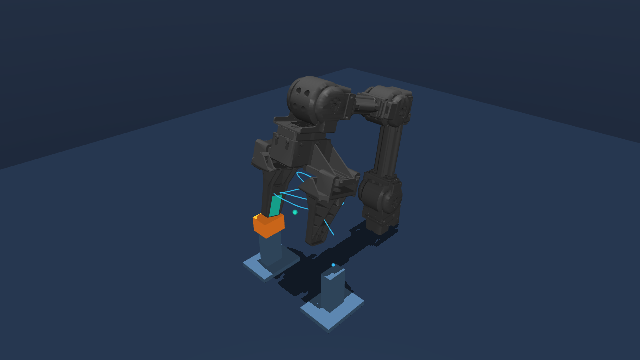

蓝色为参考曲线，橙色为已执行的末端路径。工件通过夹指摩擦接触运动。基础搬运演示保留在 [原始记录](results/native/demo.gif)。

## 机械设计

夹持附件安装在原夹爪两侧，单侧由 26 × 14 × 2 mm 铝背板和同尺寸 TPU 垫组成，计算质量为 2.8028 g。定位托座固定在工作台上，总高 55 mm，顶部支承面为 24 × 14 mm，给夹指留出进入空间。

模型由 `cad/design.json` 和 `cad/build.py` 生成。[CAD 文件](cad/generated/) 包含零件 STEP/STL、单侧附件装配 STEP 和参考尺寸图。材料和胶粘连接尚未经过实物验证，当前成果为设计与仿真。

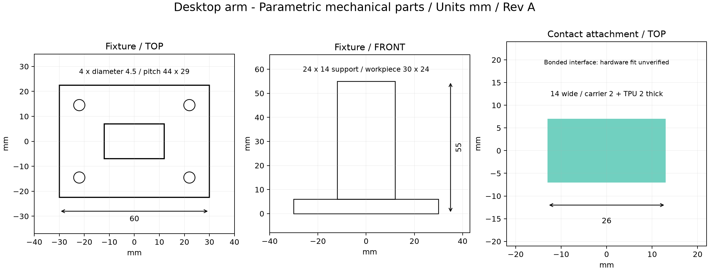

## 运动与控制

- 四轴运动学采用上游关节坐标，支持位置和径向俯仰的正解、解析逆解及位置雅可比计算。
- 三次、五次关节轨迹按速度和加速度限值进行时间缩放；默认使用段端速度、加速度为零的五次轨迹。
- 位置伺服叠加动力学偏置补偿，关节力矩限制为 ±2 N·m，夹爪驱动力限制为 ±6 N。
- ROS 2 任务节点通过 `FollowJointTrajectory` 和 `GripperCommand` 驱动仿真控制节点，并接收关节与位姿反馈。
- 执行前可检查任务参数、目标可达性及采样路径上的托座/地面相交。检查范围见 [工况评估](docs/工况评估.md)。
- 任务可指定不同高度的托座、固定隔挡和转移途经点；各段仍使用受速度、加速度约束的关节轨迹。

## 连续轨迹控制

转移阶段支持空间八字、升高螺旋和多拐弯样条，位置与工具径向俯仰同步变化。输入 8–100 个 `[x, y, z, pitch]` 位姿点，生成七次样条并逐点求解连续的逆运动学分支；中间途经点不要求停下。该机械臂仍为四自由度，不能独立指定任意六维姿态。

关节位置、速度、加速度和 jerk 的极值通过分段多项式驻点与端点计算，再统一调整运动时长。默认限值为 0.8 rad/s、1.5 rad/s²、8 rad/s³。执行时在原位置伺服上加入速度前馈，驱动力矩仍限制为 ±2 N·m。

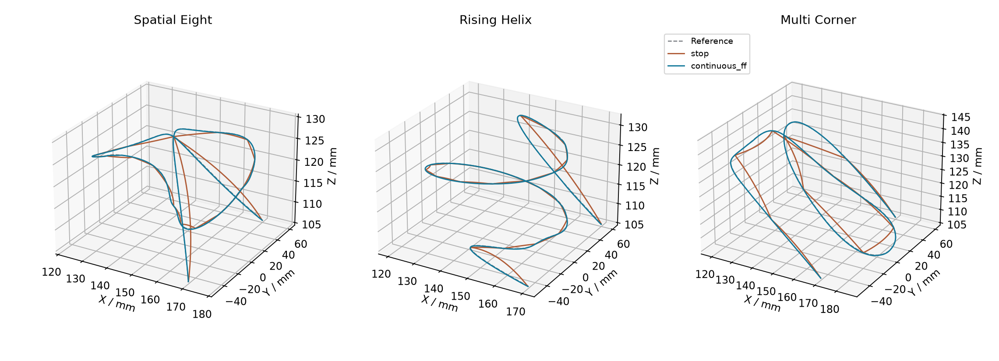

| 轨迹 | 位姿点数 | 逐点停走转移时间 / s | 连续转移时间 / s | 连续运动跟踪 RMS，关闭 → 开启速度前馈 / mm |
|---|---:|---:|---:|---:|
| 空间八字 | 19 | 18.139 | 12.567 | 1.843 → 0.134 |
| 升高螺旋 | 23 | 19.446 | 15.416 | 1.188 → 0.128 |
| 多拐弯样条 | 11 | 11.689 | 8.717 | 2.346 → 0.168 |

三组均在仿真中夹持 30 g 工件完成搬运。表中的跟踪误差比较同一时刻的指令和实际 TCP，限于转移阶段；开启前馈后的最终放置偏差分别为 0.747、0.335、0.623 mm。逐点基线同样满足速度、加速度和 jerk 限值，但它走的是途经点之间的关节直线，几何路径与连续样条不同。

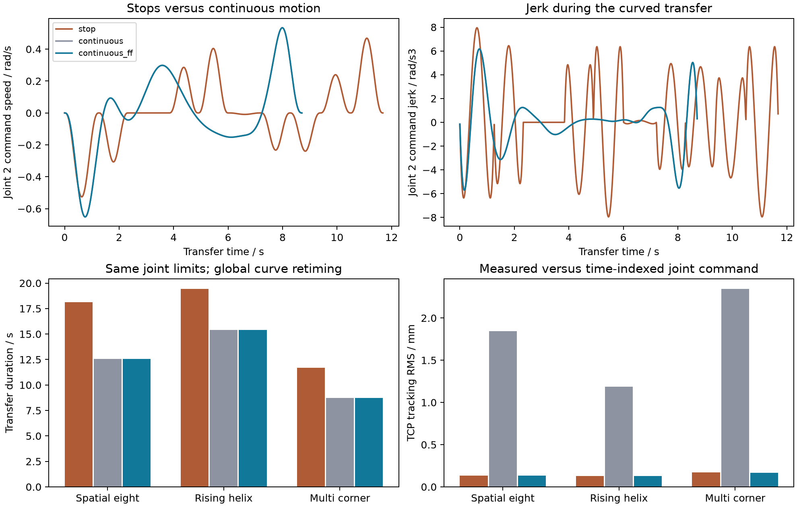

另做了参数分配和 jerk 限值对照。多拐弯轨迹的 jerk 上限从 8 降到 2 rad/s³ 后，转移时间由 8.717 s 增至 12.714 s；升到 30 rad/s³ 后时间未缩短，因为加速度约束仍起作用。16 个配置中有 14 个执行并完成搬运，另 2 个因路径相交或逆解检查失败而拒绝执行。

ROS 连续任务使用带位置、速度、加速度的五次 Hermite 插值，在每个 2 ms 仿真步计算指令。Windows 双进程多拐弯实验的跟踪 RMS 误差为 0.168 mm，放置偏差为 0.619 mm。七次原生样条与 ROS 五次插值的连续性区别、轮廓误差定义、失败工况及复现命令见 [连续轨迹说明](docs/连续轨迹控制.md)，完整数据见 [实验记录压缩包](results/continuous-motion/traces.zip)。

## 恒力接触作业

机械臂末端增加一个轴向浮动探头，在工件表面完成 50 mm 直线扫描。探头采用弹簧、阻尼和行程限位的等效结构模型；水平位置按五次曲线运动，竖直方向根据接触力调整高度。控制器只接收名义表面高度和力信号，不读取实际工件高度或倾角。

目标接触力为世界 Z 方向 2 N，默认弹簧刚度 800 N/m。仿真接触力经过噪声、10 ms 延迟和低通滤波后送入导纳控制器；结果中的力误差用未加噪声的物理仿真值计算。

| 对照工况 | 固定高度控制力 RMS 误差 / N | 力反馈控制力 RMS 误差 / N |
|---|---:|---:|
| 水平面，名义高度 | 0.083 | 0.007 |
| 水平面，实际高出 2 mm | 1.353 | 0.007 |
| 水平面，实际低于 2 mm | 1.517 | 0.008 |
| 倾斜 3° 的表面 | 0.672 | 0.081 |

表中使用相同的 800 N/m 探头，扫描时间均为 8 s。力反馈组的实际扫描接触比例均为 100%；固定高度组在低表面工况出现短时失去接触。

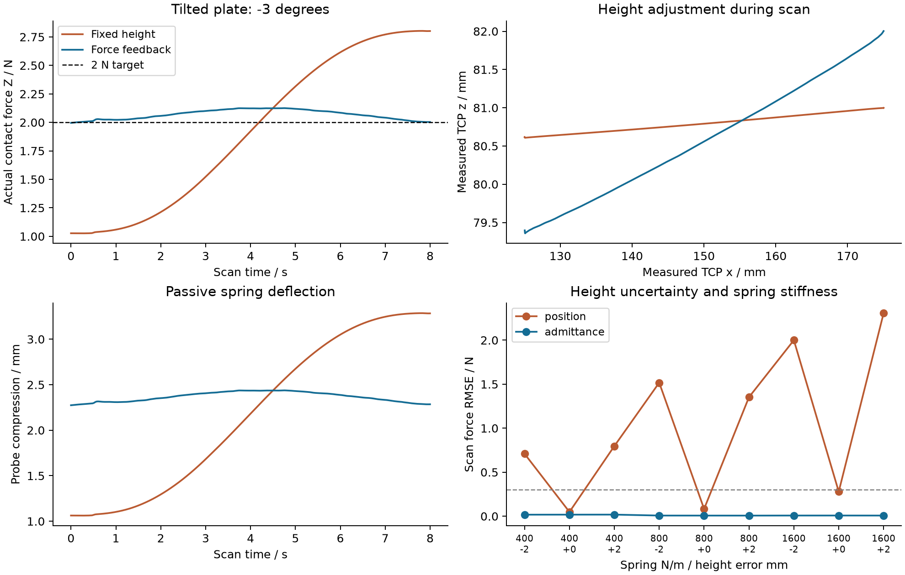

26 个工况包含 400/800/1600 N/m 弹簧、±2 mm 高度误差、倾斜表面、传感器扰动和故障。14 个满足本实验判据，12 个未满足。2 s 快速扫描的力 RMS 误差为 0.573 N，接触比例为 94.2%；加入 +0.45 N 传感器零偏后，力反馈误差为 0.415 N。缺失工件、超力和探头行程不足均触发退让，最终接触力降为零。结果来自每个配置一次仿真，不表示实机成功率。

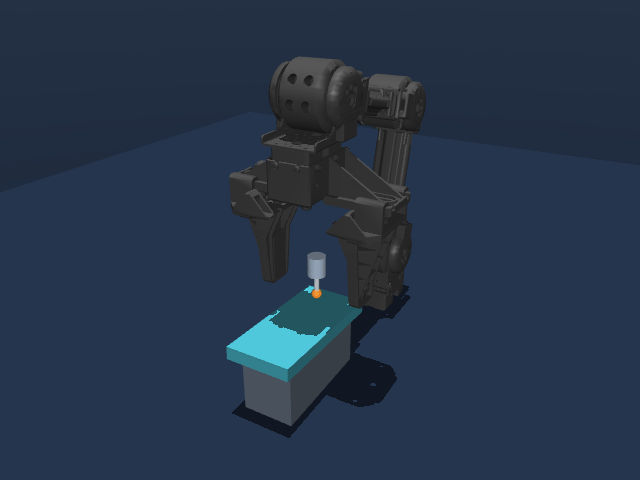

ROS 2 提供力和关节数据发布、任务启动及停止退让服务。Windows 双进程验证分别检查了完整扫描和中途停止；停止测试按预期结束扫描并退出接触。该模块尚未接入实物力传感器，也未模拟材料去除、表面质量或孔轴装配。探头结构参数、控制方程、故障记录与复现命令见 [接触作业说明](docs/恒力接触作业.md)，[原始数据](results/contact-control/traces.zip) 保留全部通过和未通过工况。

## 自动避障搬运

输入工位和障碍物位置后，程序在固定工具俯仰下用 A* 搜索转移路径。候选点先经过逆运动学和关节限位检查，连接两点时检查整段关节插值；代价使用满足速度、加速度约束的段时长。搜索完成后，对路径中的可直连节点重新检查并缩短转移时间。

碰撞模型包含机械臂、被夹工件，以及夹指背板、接触垫和金属板在估算夹持开度范围内占据的空间。默认将障碍物各面向外扩张 3 mm，再用原始尺寸模型执行接触仿真，测量实际间隙。

| 中央隔挡场景 | 转移阶段计划时间 / s | 完整仿真周期 / s | 测得最小障碍间隙 / mm |
|---|---:|---:|---:|
| 原手工侧绕路径 | 5.320 | 15.374 | 3.463 |
| 原手工跨越路径 | 3.302 | 13.358 | 0.086 |
| A* 原始网格路径 | 4.467 | 14.532 | 5.032 |
| A* 路径缩短后 | 3.042 | 13.096 | 5.006 |

原手工跨越路径的最近部位是左侧背板。新增的间隙测量将背板也计入检查；只看接触碰撞次数无法体现这条路径的间隙有多小。路径缩短使本例转移阶段的计划时间减少 31.9%，该比例针对同一次 A* 搜索所得的原始路径，不代表全局最优。

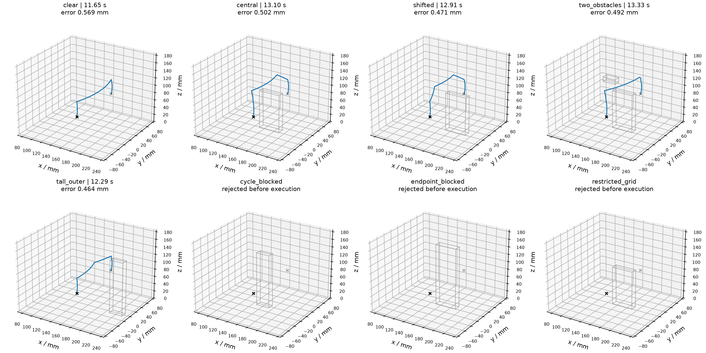

8 个场景中，5 个规划后完成仿真，位置偏差为 0.464–0.569 mm；其余 3 个分别因转移端点受阻、完整抓放流程相交或限定网格内无路而拒绝执行。另比较了 10/20/30 mm 网格和 1/3/5 mm 障碍扩张量的 9 组组合，全部完成本次中央隔挡搬运。双障碍自动路径通过 Windows ROS 2 双进程执行，放置偏差为 0.476 mm。


规划是有界网格、选定逆解分支上的离线搜索。几何检查采用采样和无滑移夹持假设；默认 3 mm 障碍扩张下，双障碍场景的执行最小间隙为 2.200 mm，说明扩张量不能直接作为动态间隙保证。参数、失败案例、ROS 日志和复现方法见 [自动规划说明](docs/自动避障规划.md)，原始数据见 [记录压缩包](results/automatic-planning/traces.zip)。

## 仿真结果

默认工件为 30 × 24 × 20 mm、30 g，从 (170, −50, 65) mm 搬到 (170, 60, 65) mm。抬升高度设为 40 mm，关节速度、加速度上限分别为 0.8 rad/s 和 1.5 rad/s²。

| 测量项 | 结果 |
|---|---:|
| 搬运周期 | 12.342 s |
| 最终工件中心偏差 | 0.569 mm |
| 最大抬升高度 | 39.945 mm |
| TCP 跟踪 RMS 偏差 | 1.903 mm |
| 机械臂与托座/地面的非预期接触步数 | 0 |
| 10 组小范围扰动 | 全部完成，位置偏差 0.376–2.613 mm |
| ROS 2 双进程搬运 | 位置偏差 0.565 mm |

位置偏差是最终工件中心到目标中心的三维距离，属于当前场景的仿真结果。判定搬运完成需同时满足偏差 < 8 mm、最大抬升 > 设定高度的 60%，以及无机械臂与托座/地面的非预期接触。

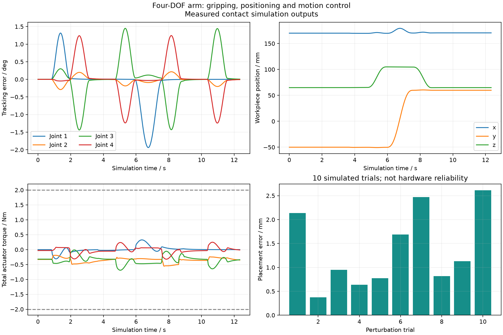

### 不同搬运任务

在相同的 30 g 工件和夹持参数下，增加了反向搬运、径向转移、高低工位及隔挡搬运。托座高度由任务配置指定，并导出了 35、55、85 mm 托座的 [STEP/STL](cad/task-fixtures/)。

| 场景 | 放置偏差 / mm | 周期 / s | 结果 |
|---|---:|---:|---|
| 原同高工位 | 0.569 | 12.342 | 完成 |
| 反向搬运 | 0.522 | 12.436 | 完成 |
| 径向与转角同时变化 | 0.558 | 12.432 | 完成 |
| 55 → 85 mm 高工位 | 0.619 | 12.806 | 完成 |
| 55 → 35 mm 低工位 | 0.593 | 12.158 | 完成 |
| 穿过 100 mm 隔挡的直接路径 | — | — | 预检拒绝 |
| 隔挡侧绕，两个途经点 | 0.521 | 15.374 | 完成 |
| 抬高跨越隔挡，两个途经点 | 0.575 | 13.358 | 完成 |

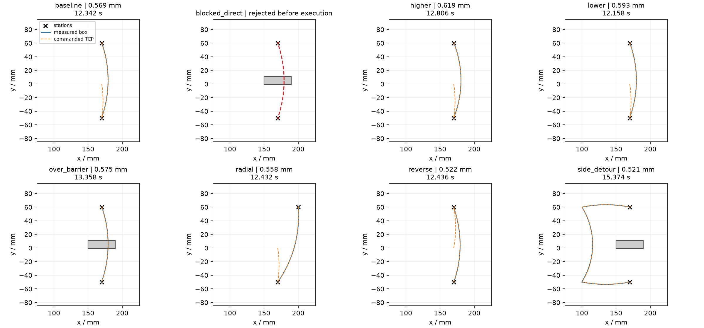

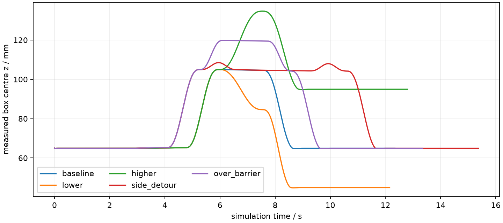

这组预设路径实验使用相同起终点和障碍尺寸。侧绕路径经过 x = 100 mm 的两个点；跨越路径将工具中心抬到 z = 120 mm。7 个可执行场景均未记录到机械臂与固定场景、工件与隔挡的碰撞，拾取抬升阶段达到约 39.9 mm。途经点由配置给定，预检按 20 ms 间隔检查；后续自动搜索结果见上节。

每个场景执行一次，结果用于比较任务和路径，不是统计成功率。配置、判据及 ROS 验证见 [搬运任务](docs/搬运任务.md)，完整 CSV 与配置见 [原始记录](results/task-suite/traces.zip)。

高工位与侧绕任务另通过 Windows ROS 2 双进程执行，位置偏差分别为 0.609、0.520 mm，均无固定场景碰撞；ROS 时间包含启动和 action 检查，与表中原生仿真周期分别记录。

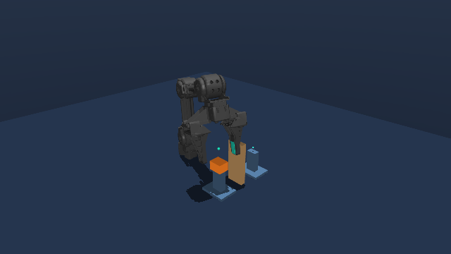

### 负载、摩擦和抬升高度

48 组组合覆盖负载 20/50/120/200 g、垫与工件摩擦 0.05/0.2/0.6/1.2，以及抬升高度 20/40/60 mm。每组运行一次，其中 6 组完成搬运，42 组未完成。

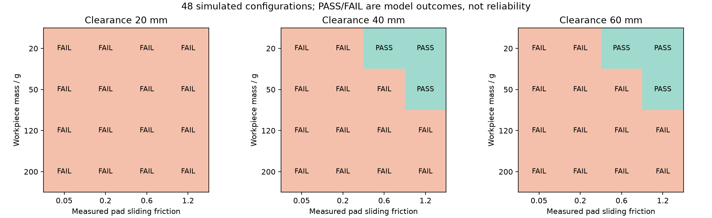

通过的组合为：20 g、摩擦 0.6 或 1.2、抬升 40 或 60 mm；50 g、摩擦 1.2、抬升 40 或 60 mm。20 mm 高度的所有组合均出现额外金属夹指接触。详细结果、失败判据和摩擦模型修正记录见 [工况评估](docs/工况评估.md)，原始配置与 CSV 保存在 [数据压缩包](results/operating-envelope/traces.zip)。这些离散工况用于检查参数影响，不构成实机负载额定值或统计成功率。

### 背板结构校核

参考边界为铝背板一短边全固定，另一短边受 6 N 分布载荷。69888 个线性四面体的端部挠度为 0.0483 mm，梁理论值为 0.0546 mm；网格细化后的挠度变化为 4.84%。另比较了 1–3 mm 厚度的背板质量、挠度和名义应力。

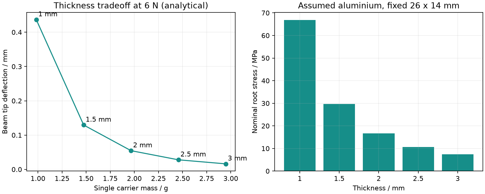

该计算覆盖背板的简化弯曲工况。胶层、TPU 非线性和加工装配误差尚未验证，详见 [设计说明](docs/设计说明.md) 和 [零件清单](docs/BOM与装配.md)。

## 运行

需要 Python 3.12。以下命令均在仓库根目录执行，路径相对于仓库；虚拟环境和输出目录可自行指定。普通仿真不依赖 ROS。

Windows PowerShell：

```powershell
python -m venv .venv
.venv\Scripts\python -m pip install -e ".[cad,test]"
.venv\Scripts\python -m desktop_arm.cli simulate --config config/task.json --preflight --output results/my-run --render
.venv\Scripts\python -m pytest -q
```

Linux：

```bash
python3 -m venv .venv
.venv/bin/python -m pip install -e ".[cad,test]"
.venv/bin/python -m desktop_arm.cli simulate --config config/task.json --preflight --output results/my-run
.venv/bin/python -m pytest -q
```

`--render` 输出视频和 GIF，需要可用的图形环境；无显示环境先运行不带此参数的仿真。依赖快照见 `requirements-lock.txt`，CI 使用 `requirements-ci.txt`。

生成 CAD 和分析数据（Linux 使用 `.venv/bin/python`）：

```powershell
.venv\Scripts\python cad/build.py
.venv\Scripts\python scripts/generate_urdf.py
.venv\Scripts\python scripts/benchmark.py --output results/my-benchmark
.venv\Scripts\python -m desktop_arm.cli assess --output results/my-assessment
.venv\Scripts\python scripts/operating_envelope.py --output results/my-envelope
.venv\Scripts\python scripts/task_suite.py --output results/my-tasks
.venv\Scripts\python scripts/export_task_fixtures.py --config config/tasks/higher.json --output results/my-fixtures
.venv\Scripts\python -m desktop_arm.cli plan --config config/planning/two_obstacles.json --output results/my-plan --execute
.venv\Scripts\python scripts/planning_benchmark.py --output results/my-planning-benchmark
.venv\Scripts\python -m desktop_arm.cli motion --config config/continuous/spatial_eight.json --output results/my-motion --render
.venv\Scripts\python scripts/continuous_benchmark.py --output results/my-motion-benchmark
.venv\Scripts\python -m desktop_arm.cli contact --config config/contact/tilted_surface.json --output results/my-contact --render
.venv\Scripts\python scripts/contact_benchmark.py --output results/my-contact-benchmark
.venv\Scripts\python -m desktop_arm.structure
```

ROS 2 的环境配置、接口和验证记录见 [ROS 运行说明](docs/ROS运行.md)。已验证 Windows Jazzy 的双进程通信与安装后 launch；Ubuntu ROS 运行及 RViz 显示尚未验证。当前接口为 MuJoCo 仿真控制桥，未接入实机驱动、MoveIt 或 ros2_control。

## 测试

自动测试共 79 项，覆盖运动学与独立模型核对、轨迹端点和约束、摩擦接触搬运、任务参数与路径检查，以及 CAD/URDF 质量惯量一致性和有限元校核。自动规划测试另检查段中碰撞、夹指开度包络、路径缩短后执行、加密采样验证、结果复现、受限网格失败和完整流程拒绝。连续轨迹测试检查导数、点间极值、逆解连续性、ROS 插值约束和带载跟踪。接触作业测试检查力坐标与符号、弹簧静力平衡、传感器延迟、固定高度与力反馈对照、快速扫描失效及故障退让。GitHub Actions 分别在 Windows 和 Ubuntu 执行；ROS action 的非法目标拒绝、重叠目标拒绝和取消验证另有 [通信记录](results/ros2/action_checks.json)。

测量方法、轨迹对照和结构网格结果见 [实验记录](docs/实验记录.md)。

## 目录

| 目录 | 内容 |
|---|---|
| `cad/` | 参数化零件、STEP/STL 和尺寸图 |
| `config/` | 任务点、负载、夹爪行程及轨迹限值 |
| `desktop_arm/` | 运动学、轨迹、接触仿真、预检和 ROS 节点 |
| `scripts/` | CAD 导出、工况实验与 ROS 验证脚本 |
| `results/` | 测量日志、汇总、图表和演示 |
| `tests/` | 自动测试 |
| `docs/` | 设计、运行和实验说明；[源码阅读索引](docs/项目阅读路线.md) |

基础机械臂采用 [ROBOTIS OpenMANIPULATOR](https://github.com/ROBOTIS-GIT/open_manipulator) 的固定版本，模型与许可证保留在 `assets/upstream`。来源和开发记录见 [PROVENANCE](docs/PROVENANCE.md)。许可证为 Apache-2.0。
