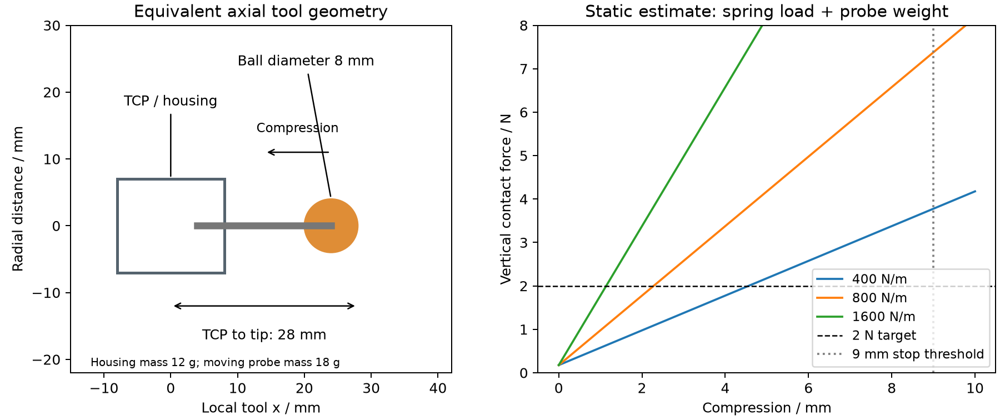
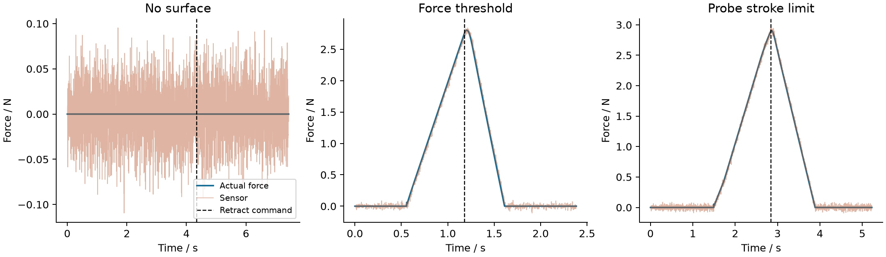

# 弹簧探头恒力接触作业

本实验让四自由度机械臂在平面工件上完成 50 mm 接触扫描，比较固定高度与力反馈控制。工件高度和倾角可以偏离名义值。任务不涉及材料去除，结果不能用于判断打磨质量、装配精度或实物传感器性能。

## 探头与接触模型

探头外壳与 TCP 刚性连接，活动探头沿工具轴滑动。机械臂保持竖直工具姿态，压缩方向为工具局部 −X，也就是世界坐标向上。原夹爪保持打开；搬运附件与被搬工件不加入这个场景。

| 参数 | 模型值 |
|---|---:|
| 外壳外径 / 轴向长度 | 14 / 16 mm |
| 球头直径 / 杆半径 | 8 / 2 mm |
| 未压缩时 TCP 到球头最低点 | 28 mm |
| 外壳 / 活动探头集中质量 | 12 / 18 g |
| 轴向弹簧刚度 | 默认 800 N/m；对照 400、1600 N/m |
| 轴向阻尼 | 3 N·s/m |
| 滑动关节范围 | −2 至 10 mm；允许小幅重力下垂 |
| 软件压缩行程阈值 | 9 mm |
| 工件平板尺寸 | 110 × 50 × 10 mm |
| 名义顶面中心 | (150, 0, 55) mm |

这是用于接触动力学的等效结构。质量是设定值，外壳使用完整圆柱碰撞包络；内部导向、弹簧线径圈数、安装支架、间隙和摩擦未做详细设计，也没有对应的加工装配图。原有夹指与托座的 CAD 文件仍属于搬运模块。



图中静力关系为 `Fz ≈ kδ + mg`，只适用于竖直、近静止探头。动态仿真还包含惯性、阻尼、关节伺服和 MuJoCo 接触柔度。自动测试用这一独立关系核对接触力符号与弹簧平衡。

探头球头与平板发生实际接触，未给球头施加预设目标力。接触力通过 [MuJoCo mj_contactForce](https://mujoco.readthedocs.io/en/stable/APIreference/APIfunctions.html#mj-contactforce) 读取，按接触坐标旋转到世界坐标；依据 [geom1 到 geom2 的受力约定](https://mujoco.readthedocs.io/en/stable/computation/index.html#contact) 选择探头受力符号。接触模型沿用有限刚度的约束求解，不表示刚性实体完全没有穿透。

## 控制与测量

水平目标从 x = 125 mm 移到 175 mm，y = 0，以端点速度、加速度为零的五次曲线运行，默认用时 8 s。世界 Z 方向力目标为 2 N；它不是倾斜表面的精确法向力，也没有控制切向力。

两种控制都先下降，再保持 1.5 s，随后扫描并抬起。固定高度组使用 `z = 名义顶面高度 + 28 mm − 目标力/弹簧刚度`；这是没有实测高度、也没有额外静力标定的位置基线。该基线在平面名义高度下本身有误差，不能把它视作所有位置控制方法的上限。

力反馈组检测到 0.3 N 后进入导纳控制：

```text
M * z_ddot + B * z_dot = Fz_filtered - F_target
M = 1.5 kg（虚拟质量），B = 220 N·s/m
```

力偏大时抬高，力偏小时下降。阻尼项采用隐式离散，竖直速度限制为 8 mm/s；搜索下降速度为 6 mm/s，最大下降范围为 26 mm。四个驱动关节仍使用位置伺服和偏置补偿，总力矩限制为 ±2 N·m。控制模块接收的设置不包含实际表面高度、倾角和是否存在工件；逆运动学不满足限位时也会终止扫描。

传感器模型取球头与平板接触力的世界 Z 分量，加零偏和高斯噪声，再进入延迟队列与低通滤波。默认噪声标准差 0.03 N、延迟 10 ms、滤波时间常数 15 ms、随机种子 42。仿真步长为 2 ms，CSV 每步记录一次。该通道不包含真实腕部力传感器的惯性载荷和标定过程。

`force_z_true` 是物理仿真值，`sensor_raw` 是经过噪声与延迟的未滤波值，`sensor_filtered` 用于导纳控制。报告中的 RMS 误差、接触比例与峰值使用 `force_z_true`。力限制判断使用 `sensor_raw`，并不直接读取无噪声真值。

## 实验与失败记录

[26 个配置的完整汇总](../results/contact-control/summary.json) 中，18 个比较三种弹簧刚度、−2/0/+2 mm 高度误差以及两种控制；其余包含倾斜平面、扫描速度、传感器与故障条件。每组执行一次，噪声使用同一随机种子，未做多种子统计。

通过判据为：完整扫描，扫描阶段真实力 RMS 误差 ≤ 0.3 N、接触比例 ≥ 99%，无非预期固定场景接触，退让结束时接触力 ≤ 0.1 N，且未触发终止或超时。接触定义为真实 Z 向力 > 0.1 N。RMS 误差包含整个扫描阶段，不剔除端点或失去接触的片段。

| 工况 | 结果 |
|---|---|
| 三种刚度 × 三种水平面高度，力反馈 | 9 组均通过，力 RMS 误差 0.007–0.018 N |
| 同样的 9 组，固定高度 | 仅 3 组名义高度通过，另外 6 组超出力误差或接触比例要求 |
| −3° 倾斜面，800 N/m，8 s 扫描 | 固定高度 0.672 N，力反馈 0.081 N |
| 800 N/m、实际高出 2 mm，2 s 扫描 | 力反馈 RMS 误差 0.573 N，接触比例 94.2%，未通过 |
| 噪声标准差 0.15 N，延迟 60 ms | 倾斜面力反馈 RMS 误差 0.081 N，本次通过 |
| 传感器加入 +0.45 N 零偏 | 实际平均力 1.599 N，RMS 误差 0.415 N，未通过 |
| 无工件表面 | 达到 26 mm 搜索范围后退让，扫描未执行 |
| 实际高出 6 mm，固定高度，力阈值 2.7 N | 触发超力退让，实际峰值 2.803 N |
| 300 N/m 弹簧，目标 4 N | 超过 9 mm 压缩阈值后退让，测得最大压缩 9.087 mm |

共 14 组通过、12 组未通过。三种故障工况的最终接触力均为零；故障被识别和退出，不等于任务成功。超力峰值高于判断阈值，反映传感器延迟和系统运动，不能把阈值当作绝对力上限。



这一组数据支持在已测范围内使用力反馈补偿高度误差，同时暴露了零偏和快速扫描的影响。尚未比较更多控制器、不同接触刚度或摩擦模型，也没有证明对任意工件形状的稳定性。

## ROS 2 接口

`desktop_arm.ros_contact` 在一个进程内执行控制与接触仿真；独立观察进程通过 DDS 接收消息并调用服务。2 ms 是仿真步长，Windows Python 计时器不保证墙钟 500 Hz。

| 名称 | 类型与含义 |
|---|---|
| `/contact/force` | `geometry_msgs/WrenchStamped`，仅 force.z 为滤波后的模拟测量；其他分量未测量，填零 |
| `/joint_states` | 四个转动关节与探头压缩位移 |
| `/contact/state` | `std_msgs/String`，下降、稳力、扫描、退让和结束状态 |
| `/contact/start` | `std_srvs/Trigger`，一次性启动，重复启动拒绝 |
| `/contact/stop` | `std_srvs/Trigger`，中止扫描并退让；空闲时拒绝 |

消息时间戳采用仿真时间，frame_id 为 world。本模块不发布 `/clock` 或 TF，也不向原搬运的 trajectory action 发送目标。

完整扫描的 [双进程验证](../results/contact-control/ros-normal/verification.json) 收到 1,259 条力消息及 1,259 条关节消息，力 RMS 误差 0.081 N，仿真时长 12.586 s，墙钟约 65.3 s。[中途停止验证](../results/contact-control/ros-stop/verification.json) 收到 494 条力消息，确认停止请求被接受，扫描标记为未完成，最终接触力为零。两项都检查了重复启动、空闲停止拒绝和时间戳递增。停止案例中途退出，不能拿它短时间片段的误差与完整扫描比较。

## 复现

从仓库根目录执行，输出目录应为空。继续使用现有 Python 环境即可，无新增依赖。Linux 将解释器路径换为 `.venv/bin/python`。

```powershell
.venv\Scripts\python -m desktop_arm.cli contact --config config/contact/tilted_surface.json --output results/my-contact --render
.venv\Scripts\python scripts/contact_benchmark.py --output results/my-contact-benchmark --render
.venv\Scripts\python scripts/plot_contact_probe.py --output results/my-probe-layout.png
.venv\Scripts\python -m pytest tests/test_contact_control.py -q
```

普通仿真返回码 0 表示通过，2 表示任务未通过；批量脚本会保留预期失败工况并继续。全部配置、2 ms 原始日志和汇总保存在 [traces.zip](../results/contact-control/traces.zip)。

Windows 已有 ROS 环境可以使用可配置入口：

```powershell
./scripts/run_ros.ps1 -Contact -RosHome <ROS依赖目录> -Pixi <pixi可执行文件> -Output <新输出目录>
./scripts/run_ros.ps1 -Contact -StopDuringScan -RosHome <ROS依赖目录> -Pixi <pixi可执行文件> -Output <另一新输出目录>
```

也可以在已激活 ROS、能够导入本项目和 MuJoCo 的终端运行 `python scripts/verify_ros_contact.py --output <新输出目录>`，追加 `--stop-during-scan` 验证停止。ROS 接触模块只验证了 Windows Jazzy；Ubuntu CI 覆盖原生仿真，不覆盖 ROS 运行。

源码从 [力控制器](../desktop_arm/force_control.py)、[物理模型与测量](../desktop_arm/contact_process.py)、[批量实验](../scripts/contact_benchmark.py) 和 [ROS 节点](../desktop_arm/ros_contact.py) 阅读。
