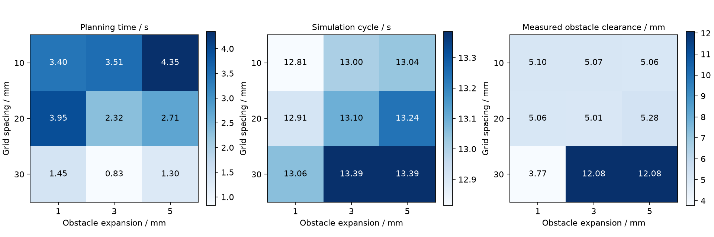

# 自动避障搬运实验

2026-10-22。新增固定俯仰下的转移路径搜索，输入为已有工位、工件和障碍物参数，输出为可交给原生仿真或 ROS 执行的任务文件。算法不需要预先填写绕障途经点，已有途经点会由搜索结果替换。

## 搜索与轨迹

候选工具中心位置采用三维规则网格，默认 x = 80–220 mm、y = −80–80 mm、z = 105–145 mm，间隔 20 mm。网格范围限定候选途经点，实际转移起终点来自任务中的抬升点和下放前位置。

各候选点经过解析逆运动学筛选，在固定俯仰与选定逆解分支上生成四关节角。网格点与最多 26 个邻点相连；两个端点分别尝试连接最近的 16 个可达网格点。先检查直接转移，直接可行时不展开网格搜索。

A* 的边代价为五次关节轨迹在速度、加速度限值下的段时长，包含每段至少 0.4 s 的约束；启发式采用仅考虑关节限速的时间下界。这里优化的是离散图上的停点间转移时间。网格路径产生后，再在原路径的有序节点间检查可直连边，用动态规划选取总段时长更短的组合。

连接节点时检查整条关节插值段，最大关节采样增量为 0.02 rad；两端点不碰撞并不能证明段中无碰撞。最终将选中节点重新转换为笛卡尔途经点，并按执行器所用的逆解和轨迹流程再次检查，避免逆解分支变化导致保存的任务与检查路径不一致。自动测试还用 0.005 rad 加密检查中央隔挡路径。

搜索不保证完整连续关节空间中的可行性或全局最优。受限网格没有路径，只表示当前候选点和连接关系内没有找到路径。

## 夹指与工件的几何检查

夹住工件后，夹爪实际开度由工件和接触力决定，不能只按闭合指令检查外形。程序将工件在夹持方向上的投影半宽与模型中的垫内表面位置比较，估算接触开度，再增加 2 mm 开度余量，并受任务张开量限制。默认工件的检查范围约为 −9.000 至 −2.134 mm。

在该范围的中间开度建立夹指模型，沿滑动轴扩展背板、接触垫和金属板，覆盖整个开度区间。测试用区间内的多个开度核对各零件的全部顶点是否落在包络内。这个范围是几何估算，执行后另核对实际左右夹爪开度是否超出范围。

被夹工件按拾取时的相对姿态随工具运动，初始偏移也进入估算。转移检查覆盖移动机械臂及工件与固定托座、地面和障碍物的相交；障碍物默认每个方向增加 3 mm 半尺寸。搜索模型只用于几何计算，执行模型保留原尺寸、自由工件和摩擦接触。

完整抓放周期仍需通过原有的采样预检，包括接近、抬升、下放、张开和撤离。新增开度包络和障碍扩张用于转移段，其他阶段沿用原有检查；不检查机器人自碰撞，也不提供连续扫掠保证。障碍物用固定长方体近似，其中悬置方块可表示上方伸出部，未建模其安装结构。

## 场景结果

各场景沿用 30 g 工件、μ = 1.2、五次轨迹及原执行器限值，每个配置运行一次。

| 场景 | 规划与执行 | 放置偏差 / mm | 仿真周期 / s | 转移阶段最小障碍间隙 / mm |
|---|---|---:|---:|---:|
| 无障碍 | 保留直接转移，完成 | 0.569 | 11.654 | 无障碍 |
| 中央隔挡 | 自动跨越，完成 | 0.502 | 13.096 | 5.006 |
| 隔挡外移 | 自动调整途经点，完成 | 0.471 | 12.912 | 6.713 |
| 两个障碍 | 自动调整路径，完成 | 0.492 | 13.334 | 2.200 |
| 外侧高隔挡 | 自动绕过，完成 | 0.464 | 12.294 | 4.803 |
| 抓放流程受阻 | 转移路线存在，完整流程预检拒绝 | — | — | — |
| 转移端点受阻 | 开度包络与障碍相交，拒绝 | — | — | — |
| 限制搜索网格 | 候选点限制在窄范围，搜索失败 | — | — | — |

无障碍场景的待机点位于拾取工位上方，因此周期不能直接与早期默认任务的 12.342 s 对比。被拒绝的场景不运行接触搬运，也不生成可供执行的任务文件。

间隙在转移相关阶段的每个 2 ms 物理步计算，为障碍物与活动碰撞几何、工件、背板之间的最小有符号距离。背板在原动力学模型中仅贡献质量，未启用碰撞响应；新增几何测量将它纳入检查，负间隙会使本次原生规划执行判定失败。CSV 仍每 10 ms 记录，汇总最小值可能发生在 CSV 采样点之间。

默认扩张量为 3 mm，双障碍执行的最小间隙却为 2.200 mm。规划检查与实际执行存在跟踪误差和夹持姿态差异，扩张量并不是动态间隙的保证。5 个执行场景都满足位置、抬升和碰撞判据，测得夹爪开度均在估算包络范围内；这些单次结果不构成实机安全性或统计成功率验证。

## 路径缩短与参数比较

中央隔挡的 A* 原始网格路径转移时间为 4.467 s，缩短后为 3.042 s，减少 31.9%；完整仿真周期由 14.532 s 变为 13.096 s。原始路径放置偏差为 0.377 mm，缩短后为 0.502 mm，缩短时间并没有同时减小放置误差。

同一场景下，手工侧绕周期 15.374 s、间隙 3.463 mm；手工跨越周期 13.358 s、间隙仅 0.086 mm。两者均完成本次仿真，但左侧背板在手工跨越时非常接近隔挡。自动路径的对应最小间隙为 5.006 mm。



9 组比较覆盖 10/20/30 mm 网格间隔与 1/3/5 mm 障碍扩张量，均完成中央隔挡搬运。实测周期为 12.814–13.386 s，最小间隙为 3.770–12.077 mm。参数变化会改变选中的离散路线，间隙和周期不呈简单线性关系；细网格也不保证路径缩短后的结果优于所有粗网格路线。

规划墙钟时间是单次测量，包含建模、搜索和最终预检，会受系统负载影响。A* 展开节点数、边检查数、采样数和原始路径一起保存在各场景的 `planning.json`，可用于比对计算量。默认中央隔挡展开 64 个节点；9 组参数实验展开 23–531 个节点。

## ROS 验证与复现

双障碍场景的搜索结果交给 Windows Jazzy 的两个独立 ROS 节点执行，位置偏差为 0.476 mm，拾取阶段抬升 39.921 mm。仿真时间 14.642 s、墙钟时间 64.130 s，包含启动和 action 检查。该运行通过非法目标、重叠目标和取消检查，未记录到机械臂或工件与障碍的接触；ROS 运行没有逐步测量背板间隙，不能套用原生运行的 2.200 mm。退出时仍存在已记录的 `Destroyable` 与 timer 清理提示。

action 检查脚本现在读取同一任务配置，在该任务的初始位姿进行保持和取消检查，避免切换任务后仍向原默认初始点发指令。

仓库根目录下执行，输出目录需为空，以保留已有记录：

```powershell
.venv\Scripts\python -m desktop_arm.cli plan --config config/planning/two_obstacles.json --settings config/planning/settings.json --output results/my-plan --execute --render
.\scripts\run_ros.ps1 -RosHome '<ROS_DEPENDENCY_WORKSPACE>' -Config results/my-plan/resolved_task.json -Output results/my-plan-ros
.venv\Scripts\python scripts/planning_benchmark.py --output results/my-planning-benchmark
```

`plan` 不加 `--execute` 时只生成路径。成功输出 `resolved_task.json`；拒绝时保存输入与原因，以非零退出码结束。普通原生执行或 ROS 节点均可读取该任务文件，执行阶段不重新搜索路径。

证据：[汇总](../results/automatic-planning/summary.json)、[规划与原生 CSV](../results/automatic-planning/traces.zip)、[ROS 日志与结果](../results/automatic-planning/ros-two-obstacles/)、[ROS CSV](../results/automatic-planning/ros-traces.zip)。
