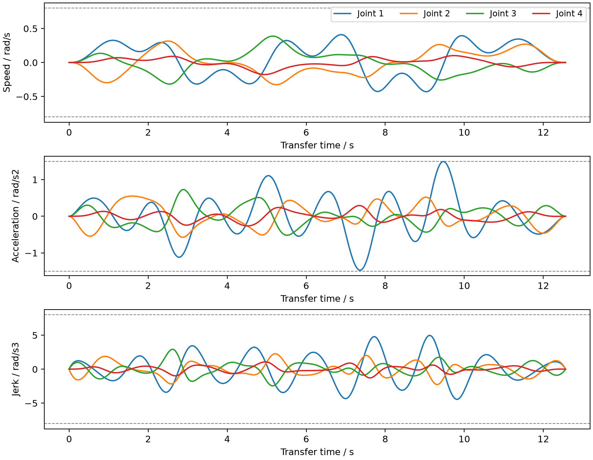

# 连续位姿轨迹与带载跟踪

这一模块处理连续空间曲线：机械臂夹起工件，沿给定轮廓改变位置与工具俯仰，再回到放置工位。曲线用于运动控制对照，没有把八字或螺旋命名为已经完成的加工工艺。

## 轨迹生成

配置位于 [config/continuous](../config/continuous/)。每个位姿点包含位置三分量和径向俯仰角，单位为米和弧度。首末点必须等于拾取、放置工位上方的位姿。四自由度结构决定了可控制的姿态范围，不能独立指定工具滚转与偏航。

先对位姿点构造七次插值样条，端点的一至三阶参数导数设为零。参数可以等间隔分配，也可以按相邻位置点的弦长累计分配；弦长参数不等于曲线的精确弧长。两种分配还会改变点间曲线形状，不应把它们的时长差全归因于同一几何路径上的时间优化。

程序在默认 401 个均匀参数点和原位姿点处求解逆运动学，每次优先选择接近前一解的分支。相邻关节解跳变超过 0.2 rad 时拒绝，提示存在分支或采样问题。然后对关节解构造七次样条，在拟合节点之间的中点检查 TCP 重建偏差，阈值为 0.05 mm。该检查验证数值表示，不代表实机定位精度。

样条构造使用 [SciPy make_interp_spline](https://docs.scipy.org/doc/scipy/reference/generated/scipy.interpolate.make_interp_spline.html)，随后转换为 [分段多项式](https://docs.scipy.org/doc/scipy/reference/generated/scipy.interpolate.PPoly.from_spline.html) 求各段导数极值。对每个关节检查位置上下界；速度、加速度和 jerk 的候选极值来自段端点及下一阶导数的实根。每段先归一化到 `[0,1]` 再求根，减少区间尺度差异的影响。

设归一化轨迹的三阶导数峰值为 V、A、J，总时长取：

```text
T = 1.002 * max(1 s, max(V / vmax), max(sqrt(A / amax)), max(cbrt(J / jmax)))
```

默认关节限值为 0.8 rad/s、1.5 rad/s²、8 rad/s³。这是对选定曲线和参数分配的整体时间缩放，不是全局时间最优或在线重规划。浮点求根不属于严格区间证明，因此测试另在 5,001 个时间点核对导数上限，并用时间差分检查解析导数。

连续转移的七次样条内部光滑，首末速度、加速度和 jerk 为零。前后抓放动作仍使用五次关节段，并增加 jerk 对时长的限制；这些段之间不保证 jerk 连续。因此不能把完整抓放任务称为处处 jerk 连续。

## 执行与前馈

原位置伺服包含关节速度阻尼。增加目标速度补偿后，理想未限幅控制形式为：

```text
tau = Kp * (q_des - q) + Kv * (dq_des - dq) + bias
```

补偿通过执行器目标位置实现，仍受原 ±2 N·m 总力矩限幅约束。只在曲线转移阶段使用速度前馈，抓放阶段保留原控制方式。此处没有新增期望加速度的逆动力学前馈，也没有训练控制策略。

指令导数满足限值，不代表实际关节速度、加速度或 jerk 被硬限幅。真实响应还受接触、摩擦、伺服滞后和力矩饱和影响；日志同时记录指令与测量值。工件保持自由刚体，通过夹爪接触运动，没有焊接或跟随式位置赋值。

执行前仍进行完整流程的 20 ms 采样碰撞检查，并在动态执行中记录非预期接触。预检没有连续扫掠保证，且不验证自碰撞、动态滑移或所有夹持开度包络。样条可能超出途经点的外包范围，不能仅凭途经点没有碰撞就判断整条曲线可执行。

## 对照结果

所有主对照使用相同的 30 g 工件、位姿点、关节限值和夹持参数，每个配置执行一次：

- `stop`：途经点之间走关节直线，使用七次静止到静止曲线，每个途经点速度、加速度与 jerk 归零，不额外插入停留时间。
- `continuous`：连续样条，关闭速度前馈。
- `continuous_ff`：相同连续样条和时间参数，开启速度前馈。

逐点与连续方式经过相同途经点，但点间几何路径不同。时间对比与轮廓偏差需一起看；只有关闭/开启前馈两组严格使用相同的指令轨迹。

| 轨迹 | 逐点时间 / s | 连续时间 / s | 关闭前馈跟踪 RMS / mm | 开启前馈跟踪 RMS / mm | 开启前馈放置偏差 / mm |
|---|---:|---:|---:|---:|---:|
| 空间八字，19 点 | 18.139 | 12.567 | 1.843 | 0.134 | 0.747 |
| 升高螺旋，23 点 | 19.446 | 15.416 | 1.188 | 0.128 | 0.335 |
| 多拐弯，11 点 | 11.689 | 8.717 | 2.346 | 0.168 | 0.623 |

表中时间只包括转移阶段，不包括夹取和放置。前三组默认配置分别采用弦长、弦长、等间隔参数。连续转移的工具俯仰范围分别约为 61.9–74.5°、63.7–74.5°、62.4–74.5°，并非固定姿态平移。


跟踪误差比较同一时刻的实际 TCP 与指令 TCP。轮廓误差则测量到 20,001 个理想曲线采样点中最近点的距离，包含离散化误差，也可能在曲线自交处选到另一分支，不能替代时间跟踪误差。八字的前馈使跟踪 RMS 从 1.843 mm 降到 0.134 mm，但实际轮廓 RMS 仅从 0.097 mm 变为 0.090 mm，主要改善的是沿路径的滞后。

逐点基线的实际轮廓 RMS 为 0.935、0.946、2.686 mm；开启前馈的连续轨迹为 0.090、0.079、0.109 mm。参考曲线的几何差异是这一对比的一部分。



参数分配对照中，八字采用等间隔参数时为 19.389 s，改用弦长后为 12.567 s；螺旋为 23.995 → 15.416 s。多拐弯反而由等间隔的 8.717 s 增至弦长的 11.202 s，所以配置保留等间隔。选择由这组对照确定，不是自动寻找全局最优参数。

多拐弯的 jerk 上限降为 2 rad/s³ 后，时间增至 12.714 s；增大到 30 rad/s³ 后仍为 8.717 s，此时加速度约束决定时长。完整 [16 个配置](../results/continuous-motion/summary.json) 中，14 个执行并完成搬运；在路径中加入隔挡的配置被预检拒绝，另一个包含 x = 0.5 m 目标的配置被逆解连续性检查提前拒绝。没有把被拒绝场景计为成功搬运。

完成搬运仍沿用放置偏差小于 8 mm、拾取抬升充分以及无固定场景碰撞的判据；这不是加工精度合格判据，也不是统计可靠性结论。

## ROS 2 执行

连续任务仍通过 `FollowJointTrajectory` 和 `GripperCommand` 执行。客户端每隔不超过 20 ms 发送位置、速度和加速度，服务器以这些数据构造五次 Hermite 插值，并检查每个插值区间内部的位置及导数极值。缺失导数或插值超限的连续任务目标会被拒绝。没有 `curve_transfer` 的原任务保留原有位置插值接口。

接收 action 后，插值指令在每个 2 ms 仿真步计算，action 回调只负责反馈、完成和取消。ROS 五次插值保证位置、速度、加速度连续；jerk 可能在采样点有小幅跳变，因此它是七次原生轨迹的近似，不宣称两者数学上完全相同。速度前馈仍在总执行器力矩限幅内。

[多拐弯 ROS 记录](../results/continuous-motion/ros-corner/summary.json) 包含 2,157 条测量样本，转移跟踪 RMS 为 0.168 mm，放置偏差为 0.619 mm；仿真总时长 21.584 s，墙钟约 118.1 s。13 个 arm action 包含取消测试，接口还验证了非法目标与重叠目标拒绝。[原搬运回归](../results/continuous-motion/ros-legacy-regression/summary.json) 放置偏差为 0.565 mm，也完成了同样的 action 检查。

Windows Jazzy 退出时仍出现已有的 Destroyable/timer jump callback 警告，进程返回码为零；日志保存在对应数据压缩包。ROS 运行只在 Windows 验证，Ubuntu CI 运行的是不依赖 ROS 的原生仿真及插值测试。2 ms 是仿真步长，不能解读为 Windows Python 实时控制性能。

## 运行与数据

从仓库根目录执行，输出目录应为空；环境和实验输出位置可以自行选择。未增加 Python 依赖。

```powershell
.venv\Scripts\python -m desktop_arm.cli motion --config config/continuous/spatial_eight.json --output results/my-motion --render
.venv\Scripts\python scripts/continuous_benchmark.py --output results/my-motion-benchmark --render
.venv\Scripts\python -m pytest tests/test_continuous_motion.py -q
```

已有 ROS 环境使用：

```powershell
./scripts/run_ros.ps1 -RosHome <ROS依赖目录> -Pixi <pixi可执行文件> -Config config/continuous/multi_corner.json -Output <新输出目录>
```

Linux 的原生仿真将解释器路径替换为 `.venv/bin/python`。动画中的蓝色线是完整参考曲线，橙色线是已执行的 TCP 路径，叠加线条不参与碰撞和动力学。

[完整实验压缩包](../results/continuous-motion/traces.zip) 保存配置、规划与预检报告，以及动态执行 CSV。正常抓放阶段使用旧五次段，其 CSV jerk 指令列留空；连续转移和逐点对照段记录解析 jerk。ROS 原始数据分别见 [连续任务](../results/continuous-motion/ros-corner/traces.zip) 与 [原任务回归](../results/continuous-motion/ros-legacy-regression/traces.zip)。

核心代码为 [连续样条与极值计算](../desktop_arm/continuous.py)、[action 插值](../desktop_arm/action_trajectory.py)、[结果测量](../desktop_arm/motion_experiment.py) 和 [批量对照](../scripts/continuous_benchmark.py)。
